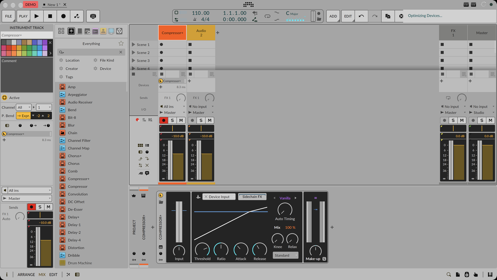

# Graphite Light for Bitwig Studio

A light skin for Bitwig Studio, loaded with [Patchbay](https://github.com/shaboogen-dev/Patchbay) (BML). Patchbay patches Bitwig in memory when it starts. Bitwig's own files are never changed, so to undo the skin you untick it and restart Bitwig.

*Bitwig Studio 6.1.8 in Demo mode with all four packages enabled.*

## What's in it

| Package | Type | Version | What it does |
|---|---|---|---|
| Graphite Light | theme (Framework: Themes) | 0.6.0 | The colour palette: 84 Bitwig colours, light grey panels, dark displays, amber accent. |
| Graphite Light: Widgets, Layout & Indicators (`graphite-widgets`) | mod | 0.6.0 | Flat knobs with cyan value arcs, flat device headers and buttons, browser on the left, transport on grey, neutral scene rows, readable icons on light and dark surfaces, cyan traces on dark displays, amber/grey device lamps, EQ+ bypass curve, Inspector enable indicators. |
| Graphite Light: Surface-Aware Ink Guard (`graphite-ink-guard`) | mod | 0.6.0 | Keeps text and icons readable: when ink falls below 4.7:1 contrast against what is actually painted under it (3:1 for faint text and icons), only its lightness is adjusted. |
| Graphite Light: Device Panel Styles (`graphite-devices`) | mod | 0.6.0 | Applies light panel and control styles to Bitwig's 152 built-in devices in memory, as they load. |

The theme works on its own. For the full look, enable the three mods as well.

## Requirements

- macOS (Apple silicon or Intel). Windows and Linux have not been tested.
- Bitwig Studio **6.1.8** or **6.1.4**. On 6.1.8 all 152 built-in devices were captured in a sandboxed session. On 6.1.4 only Patchbay's offline check has been run. Other versions have not been verified.
- Patchbay 0.36.0-dev.17 (tested).
- **Framework: Themes** (`bte-theme-loader`) from the [Patchbay Mods releases](https://github.com/shaboogen-dev/Mods/releases). Recent Patchbay releases ship without mods, so add it first if you don't have it.

## Install

1. Download the ZIPs from this repo's [Releases](https://github.com/mradziwanowski/magnetic-revival-bitwig-theme/releases) page.
2. **Bitwig 6.1.8 only:** Patchbay doesn't ship a map for 6.1.8 yet, so the release includes one. Unzip `macos-6.1.8-map1.zip` into Patchbay's `maps/` folder. You should end up with `maps/macos-6.1.8-map1/`. On 6.1.4, skip this step.
3. In Patchbay, go to **Mods → Add Mod…** and add `graphite-widgets-0.6.0.zip`, `graphite-ink-guard-0.6.0.zip` and `graphite-devices-0.6.0.zip`. Leave them zipped. You can also drag them onto the Patchbay window.
4. Unzip `graphite-light-theme-0.6.0.zip` into Patchbay's `components/` folder. You should end up with `components/graphite-light/`. Add Mod only takes mods, so the theme has to be copied in by hand.
5. Tick **Framework: Themes** and the three Graphite Light mods. Choose **Graphite Light** under the **Themes** tab, then click **Load**.
6. If Bitwig was already open, restart it.

To remove the skin, untick the mods (and choose another theme or untick Framework: Themes), click **Load** and restart Bitwig.

**Coming from the 0.5.1 test release?** It used other mod IDs. Remove its three mods and its theme folder first, because both sets patch the same places in Bitwig.

## Building from source

The mods' Java source is in `mods/<mod-id>/src/`. They are compiled against Bitwig 6.1.4 (macOS) with Patchbay's modkit, as described in the Patchbay SDK docs (`docs/sdk/building.md`). Each release ZIP also contains the mod's source.

## Notes

- Bitwig shows a few views differently from frame to frame: modulator selection boxes, animated displays, history graphs. These differences have nothing to do with the skin.
- Not affiliated with, or endorsed by, Bitwig GmbH. "Bitwig" is a trademark of Bitwig GmbH.

## License

MIT (see [LICENSE](LICENSE)).
