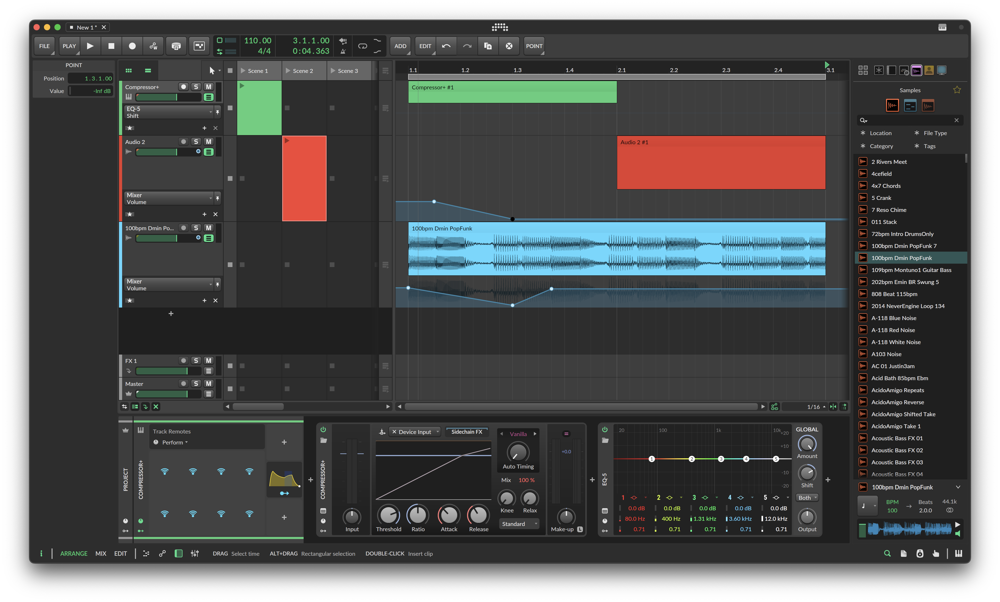

# Magnetic Revival Bitwig Theme

This is a custom theme for Bitwig Studio, created using the [Berikai/bitwig-theme-editor](https://github.com/Berikai/bitwig-theme-editor)

## Preview

## Installation

1. Download the theme editor from https://github.com/Berikai/bitwig-theme-editor
2. Clone this repo 
3. Using editor choose json file with theme config values
4. Screenshot made with Midtones 90, Black level 50, Gridlines 7

## Live 12 Light skin for Patchbay

This repo also has a light, Ableton Live 12–style skin for Bitwig Studio that loads through [Patchbay](https://github.com/shaboogen-dev/Patchbay). It is made of a colour theme for Framework: Themes and three mods (widgets, contrast guard and device panel styles). Download the ZIPs from [Releases](https://github.com/mradziwanowski/magnetic-revival-bitwig-theme/releases). Install steps, requirements and source are in [patchbay/live12-skin](patchbay/live12-skin/README.md).

## Customization

This theme can be further customized using the Berikai Bitwig theme editor. For more information, visit the [Berikai theme editor project page](https://github.com/berikai/bitwig-theme-editor).

## Acknowledgements

Special thanks to [Berikai](https://github.com/berikai) for creating the Bitwig theme editor.