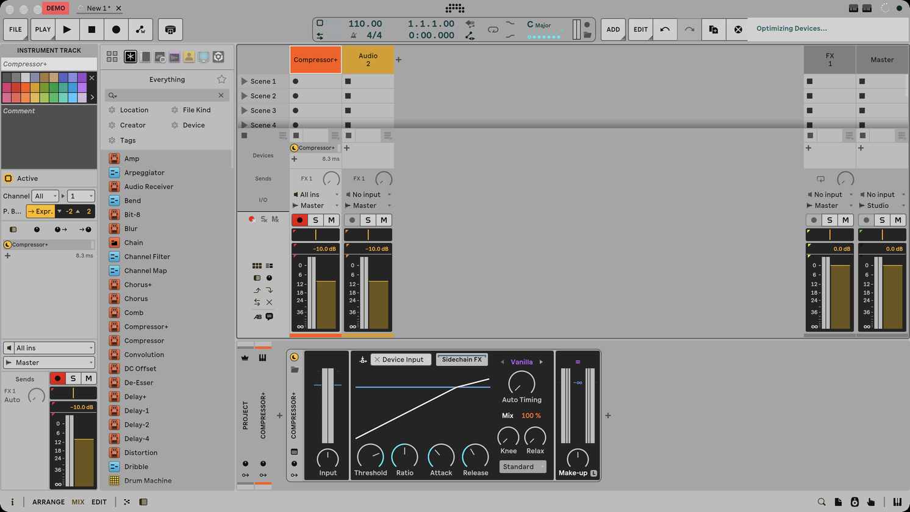

# Live 12 Light skin for Patchbay

A light, Ableton Live 12–style look for Bitwig Studio, loaded with [Patchbay](https://github.com/shaboogen-dev/Patchbay) (BML). Patchbay patches Bitwig in memory when it starts. Bitwig's own files are never changed, so to undo the skin you untick it and restart Bitwig.

*Screenshot from Bitwig 6.1.8 in Demo mode. It also uses a font that is not part of this release (see [Fonts](#fonts)).*

## What's in it

| Package | Type | Version | What it does |
|---|---|---|---|
| Live 12 Light | theme (Framework: Themes) | 0.5.1 | The colour palette: 84 Bitwig colours, light grey panels, dark displays, amber accent. |
| Live 12 Skin: Widgets, Layout & Indicators (`live12-widgets`) | mod | 0.5.1 | Flat knobs with cyan value arcs, flat device headers and buttons, browser on the left, transport on grey, neutral scene rows, readable icons on light and dark surfaces, cyan traces on dark displays, amber/grey device lamps, EQ+ bypass curve, Inspector enable indicators. |
| Live 12 Skin: Surface-Aware Ink Guard (`live12-ink-guard`) | mod | 0.1.1 | Keeps text and icons readable: when text would fall below 4.7:1 contrast against what is actually painted under it (3:1 for faint text and icons), it adjusts only the lightness. |
| Live 12 Skin: Device Panel Styles (`live12-devices`) | mod | 0.1.0 | Applies Live-style panel and control styles to Bitwig's 152 built-in devices in memory, as they load. |

The theme works on its own. For the full look, enable the three mods as well.

## Requirements

- macOS (Apple silicon or Intel). Windows and Linux have not been tested.
- Bitwig Studio **6.1.8** or **6.1.4**. Tested on 6.1.8: all 152 built-in devices were captured in a sandboxed session and compared against the reference build. On 6.1.4 only Patchbay's offline check has been run. Other versions have not been verified.
- Patchbay 0.36.0-dev.17 (tested).
- **Framework: Themes** (`bte-theme-loader`) from the [Patchbay Mods releases](https://github.com/shaboogen-dev/Mods/releases). Recent Patchbay releases ship without mods, so add it first if you don't have it.

## Install

1. Download the ZIPs from this repo's [Releases](https://github.com/mradziwanowski/magnetic-revival-bitwig-theme/releases) page.
2. **Bitwig 6.1.8 only:** Patchbay doesn't ship a map for 6.1.8 yet, so the release includes one. Unzip `macos-6.1.8-map1-live12.zip` into Patchbay's `maps/` folder. You should end up with `maps/macos-6.1.8-map1/`. On 6.1.4, skip this step.
3. In Patchbay, go to **Mods → Add Mod…** and add `live12-widgets-0.5.1.zip`, `live12-ink-guard-0.1.1.zip` and `live12-devices-0.1.0.zip`. Leave them zipped. You can also drag them onto the Patchbay window. Accept the replacement if Patchbay offers one.
4. Unzip `live12-light-theme-0.5.1.zip` into Patchbay's `components/` folder. You should end up with `components/live12-light/`. Add Mod only takes mods, so the theme has to be copied in by hand.
5. Tick **Framework: Themes** and the three Live 12 Skin mods. Choose **Live 12 Light** under the **Themes** tab, then click **Load**.
6. If Bitwig was already open, restart it.

To remove the skin, untick the mods (and choose another theme or untick Framework: Themes), click **Load** and restart Bitwig.

## Fonts

The look in the screenshot also uses Ableton Sans in place of Bitwig's UI font. Ableton Sans is Ableton's copyrighted font, so it is **not** included here, and Bitwig keeps its own font. Everything else in the skin works without it.

## Building from source

The mods' Java source is in `mods/<mod-id>/src/`, and each mod's `mod.json` lists its hooks. They are compiled against Bitwig 6.1.4 (macOS) with Patchbay's modkit, as described in the Patchbay SDK docs (`docs/sdk/building.md`). Each release ZIP also contains the mod's source.

## Notes

- Bitwig shows a few views differently from frame to frame: modulator selection boxes, animated displays, history graphs. These differences have nothing to do with the skin.
- Not affiliated with, or endorsed by, Ableton AG or Bitwig GmbH. "Ableton" and "Live" are trademarks of Ableton AG, and "Bitwig" is a trademark of Bitwig GmbH. The names are used only to describe the style.

## License

MIT, like the rest of this repository (see [LICENSE](../../LICENSE)).
